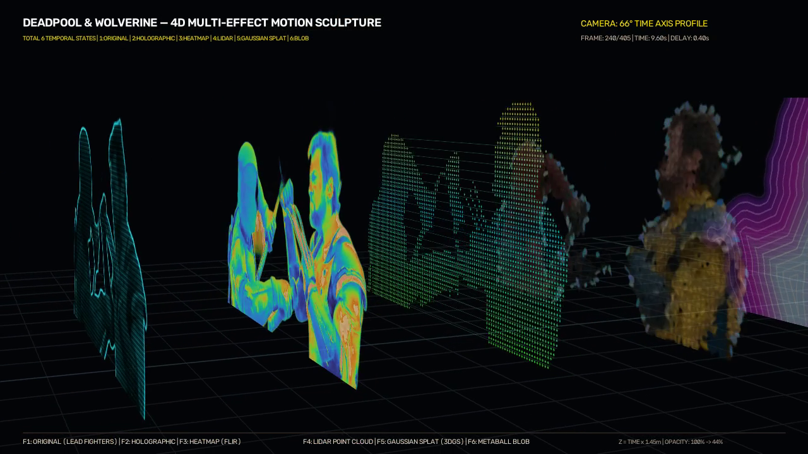

# Fight Through Time — Interactive 4D Motion Sculpture

Transform combat video footage into clean **4D space-time motion sculptures** where previous body positions remain physically suspended behind current fighters through space-time depth ($X + Y + \text{TIME} \longrightarrow X + Y + Z$, where $Z = \text{TIME} \times \text{TemporalDepth}$).



---

## 📽️ Delivered 4D Motion Sculpture Videos

### 📱 9:16 Vertical Instagram Reels Editions (1080×1920 Full HD)
1. **[`DEADPOOL_WOLVERINE_4D_MULTI_EFFECTS_REELS_9x16.mp4`](https://github.com/Utsav92/fight-through-time/blob/main/DEADPOOL_WOLVERINE_4D_MULTI_EFFECTS_REELS_9x16.mp4)** (1080×1920, 25 FPS, 405 frames / 16.20s, 15.5 MB)
   - Vertical mobile framing with safe zones, diagonal space-time cascade across 6 temporal styles.
2. **[`BRUCE_LEE_4D_MULTI_EFFECTS_REELS_9x16.mp4`](https://github.com/Utsav92/fight-through-time/blob/main/BRUCE_LEE_4D_MULTI_EFFECTS_REELS_9x16.mp4)** (1080×1920, 25 FPS, 400 frames / 16.00s, 7.5 MB)
   - Vertical mobile composition for Bruce Lee vs. Chuck Norris colosseum duel across 6 temporal styles.

### 🖥️ 16:9 Landscape Cinematic Editions (1280×720 HD)
3. **`DEADPOOL_WOLVERINE_4D_MULTI_EFFECTS.mp4`** (1280×720, 25 FPS, 405 frames / 16.20s, 13.6 MB)
4. **`DEADPOOL_WOLVERINE_4D_MOTION_SCULPTURE.mp4`** (1280×720, 25 FPS, 405 frames / 16.20s, 8.8 MB)
5. **`FIGHT_THROUGH_TIME_4D_MOTION_SCULPTURE.mp4`** (1280×720, 25 FPS, 400 frames / 16.00s, 4.0 MB)

---

## 🔬 Multi-Effect Temporal Visualization

| State | Temporal Offset | Visualization Style | Aesthetic & Technical Description |
| :---: | :---: | :---: | :--- |
| **F1** | $T - 0.0\text{s}$ | **Original** | Clean neural cutout, 100% opacity, photorealistic combat footage. |
| **F2** | $T - 0.4\text{s}$ | **Holographic** | Volumetric hologram with cyan cast, 1D scanline raster, chromatic aberration, and edge glow. |
| **F3** | $T - 0.8\text{s}$ | **Heatmap** | Thermal infrared (Turbo/FLIR colormap) mapping strikes into fiery white-hot and amber heat. |
| **F4** | $T - 1.2\text{s}$ | **LiDAR** | Discrete 3D laser scanner point cloud color-coded by elevation (green to cyan) with sweep lines. |
| **F5** | $T - 1.6\text{s}$ | **Gaussian Splat** | 3D Gaussian Splatting (3DGS) oriented ellipses aligned with image gradient vectors and soft radiance. |
| **F6** | $T - 2.0\text{s}$ | **Metaball Blob** | Signed Distance Field (SDF) fluid mass with deep violet/magenta plasma core and contour rings. |

---

## 🗂️ Repository Structure

```
fight-through-time/
├── DEADPOOL_WOLVERINE_4D_MULTI_EFFECTS.mp4     # Multi-effect 4D motion sculpture (All 405 frames)
├── DEADPOOL_WOLVERINE_4D_MOTION_SCULPTURE.mp4   # 7-state aura 4D motion sculpture
├── FIGHT_THROUGH_TIME_4D_MOTION_SCULPTURE.mp4   # Bruce Lee vs Chuck Norris 4D motion sculpture
├── blender/
│   └── fight_through_time.blend                 # Blender 4.x/5.x project with Geometry Nodes & Camera
├── web/
│   ├── index.html                               # Interactive Three.js WebGL 4D viewer
│   ├── app.js                                   # 4D time scrubber, orbit controls, depth & delay sliders
│   ├── style.css                                # Dark cyberpunk HUD interface
│   ├── three.min.js                             # Three.js runtime
│   └── OrbitControls.js                         # Camera orbit controller
├── scripts/
│   ├── render_multieffect_4d_mp4.py             # Multi-threaded renderer with 6 effects & FFmpeg streaming
│   ├── test_effects.py                          # Effect generator algorithms (Holo, Heat, LiDAR, 3DGS, Blob)
│   ├── render_deadpool_wolverine_mp4.py         # Full-clip renderer for Deadpool & Wolverine
│   ├── segment_all_dp.py                        # Neural alpha matting (u2net) pipeline
│   └── build_blender_project.py                 # Procedural Blender scene generator
└── samples_new/
    ├── effects_comparison.png                   # Side-by-side comparison of all 6 effects
    ├── rendered_frame_240.png                   # Act 3 (66° Time Profile) frame snapshot
    ├── rendered_frame_300.png                   # Act 4 (Freeze-Frame Orbit) frame snapshot
    └── composite_4d_6effects.png                # 4D composition preview
```

---

## 🎮 Interactive WebGL 4D Viewer

The `web/` folder contains a standalone Three.js WebGL application that lets users interactively manipulate the 4th dimension:
- **TIME AXIS Controller**: Drag the spacetime cursor to scrub forward and backward through the fight.
- **Interactive Orbit**: Left-click drag to rotate camera around the temporal sculpture from any angle ($0^\circ$ to $360^\circ$).
- **Pose Delay Slider**: Adjust temporal spacing between historical states ($0.1\text{s} - 1.0\text{s}$).
- **Time Depth Slider**: Control physical separation along the $Z$-axis ($Z = \text{TIME} \times \text{Depth}$).

To run locally:
```bash
cd web
python -m http.server 8000
# Open http://localhost:8000 in your browser
```

---

## 🛠️ Pipeline Architecture

1. **Neural Segmentation**:
   - `rembg` (`u2net`) runs concurrently on multi-core CPU threads to extract character silhouettes with edge preservation and remove backgrounds entirely.
2. **Space-Time Geometry Transformation**:
   - For any frame $t$, $k$ historical poses ($k \in [0, 5]$) are positioned at depth $Z_k = -k \times \text{TIME\_DEPTH}$.
   - 3D quad planar coordinates are projected through camera intrinsics $K$ and extrinsics $[R | t]$.
   - OpenCV `warpPerspective` handles perspective transformations in a single pass directly into an obsidian canvas.
3. **Piped Stream Encoding**:
   - Rendered video frames stream directly into FFmpeg `stdin` (`-c:v libx264`, `-crf 18`, `-preset veryfast`), avoiding intermediate uncompressed disk writes.

---

## 📜 License
MIT License.
